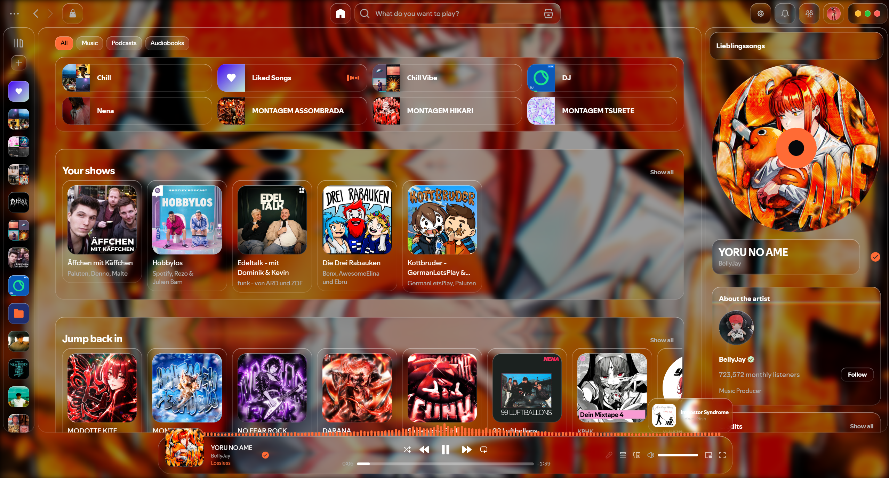

<div align="center">

# Liquify for Spicetify

**A liquid glass Spotify theme by NMW, ported from SpotiKit to Spicetify.**

[](https://www.spotify.com/download/)
[](https://spicetify.app/)
[](LICENSE.txt)

[Installation](#installation) · [Lyrics](#lyrics) · [Known issues](#known-issues) · [Building](#building-from-source) · [Credits](#credits)



</div>

> **Liquify was created by [NMW](https://github.com/NMWplays).**
> The current version of Liquify is made for [SpotiKit](https://github.com/NMWplays/SpotiKit). This is a port of that version
> ([NMWplays/Liquify @ 7548edd](https://github.com/NMWplays/Liquify/tree/7548edd08447fbe84ec0fa19e9e1d206f01d366a))
> to Spicetify. It is an unofficial community port, not supported by NMW.

## Features

- Liquid glass panels, playbar, menus and dialogs
- Liquify Settings: backgrounds, accent and dynamic colors, fonts, player layout, animations
- Animated backgrounds (Kawarp), photo and video backgrounds from your computer
- Cover art effects, visualizers and a "next song" card
- Uses Spotify's own window buttons

## Requirements

| | Version |
| --- | --- |
| Spotify Desktop | **1.3.10** (tested on 1.3.10.2586, Windows) |
| Spicetify | 2.46.7 |
| Lyrics extension | **[Liquid Lyrics for Spicetify](https://github.com/kr1zk/Liquid-Lyrics)** (recommended) or [Spicy Lyrics](https://github.com/Spikerko/spicy-lyrics) |

Other Spotify versions may work, but they are not tested.

## Lyrics

> [!IMPORTANT]
> **Use [Liquid Lyrics for Spicetify](ССЫЛКА)**, a port of NMW's [Liquid Lyrics](https://github.com/NMWplays/Liquid-Lyrics), the official lyrics extension for Liquify.
>
> [Spicy Lyrics](https://github.com/Spikerko/spicy-lyrics) from the Spicetify Marketplace also works. The original Liquid Lyrics (made for SpotiKit) does not work with this port (untested).

## Installation

1. Download the latest release (or the repository as ZIP) and extract it.
2. Put the `Liquify-main` folder in your Spicetify `Themes` directory:

   | Platform | Themes directory |
   | --- | --- |
   | Windows | `%APPDATA%\spicetify\Themes\` |
   | Linux / macOS | `~/.config/spicetify/Themes/` |

   The folder must contain `theme.js`, `user.css` and `color.ini`.

3. Run:

   ```shell
   spicetify config current_theme Liquify-main
   spicetify apply
   ```

4. Open Spotify and click the Liquify gear in the top bar to open **Liquify Settings**.

<details>
<summary><strong>Updating</strong></summary>

Replace the files in the `Liquify-main` folder with the new ones and run `spicetify apply`.

</details>

<details>
<summary><strong>Uninstalling</strong></summary>

```shell
spicetify config current_theme ""
spicetify apply
```

</details>

## Video backgrounds

Open **Liquify Settings → Background** and add a photo or video from your computer. Videos play in formats that Spotify can decode by itself (WebM / VP9 is the safest choice). There is no built-in converter in this port.

## Known issues

- Tested on Spotify **1.3.9**. There are some small visual bugs (alignment, spacing, some elements without glass). Nothing breaks the client.
- Some texts in the settings still mention SpotiKit or Liquid Lyrics. They come from the original theme.

Found a bug? Open an issue with your Spotify and Spicetify versions and a screenshot.

## Building from source

Requires Node.js 18+.

```shell
npm ci
npm run build
```

This creates `theme.js`. Edit `user.css` directly.

## Credits

- **[NMW](https://github.com/NMWplays)**: creator of [Liquify](https://github.com/NMWplays/Liquify)
- **[kr1zk](https://github.com/kr1zk/Liquify)**: separate Spicetify fork of an earlier Liquify version
- **[Liquid Lyrics for Spicetify](https://github.com/kr1zk/Liquid-Lyrics)**: Spicetify port of NMW's Liquid Lyrics
- **[Sanoojes](https://github.com/sanoojes)**: creator of [Glassify](https://github.com/sanoojes/spicetify-glassify), which inspired Liquify
- **[Spicy Lyrics](https://github.com/Spikerko/spicy-lyrics)** and **[Spicetify](https://spicetify.app/)**

Original Liquify community: [Discord](https://discord.gg/QRMnrgjhvq).

## License

Distributed under the [GNU Affero General Public License v3.0](LICENSE.txt), the same license as the original Liquify.
This port is a modified version of NMW's work. The changes are the Spicetify adaptation made in 2026.

`theme.js` bundles [@kawarp/core](https://www.npmjs.com/package/@kawarp/core) and [react-colorful](https://github.com/omgovich/react-colorful) (both MIT). See [THIRD-PARTY-NOTICES.txt](THIRD-PARTY-NOTICES.txt).
